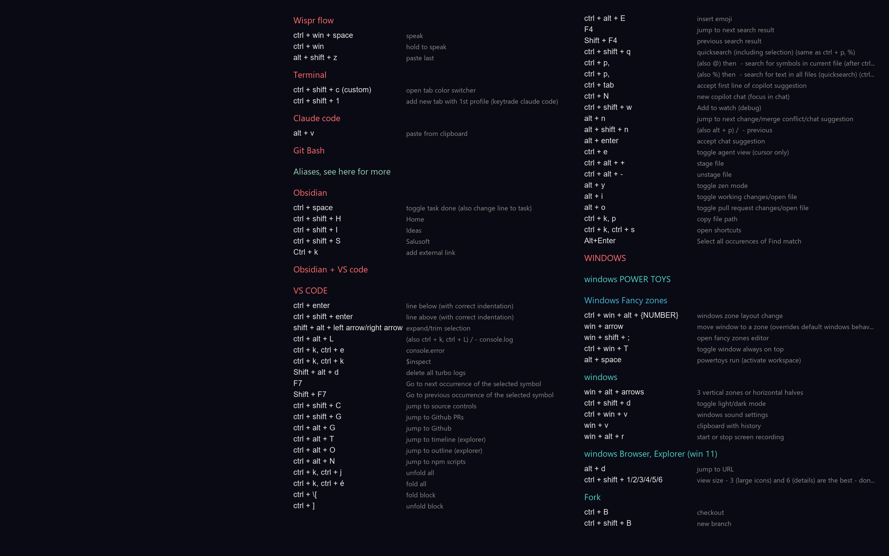

# Markdown to Desktop Background

A Python tool that converts a Markdown file containing keyboard shortcuts into a styled desktop wallpaper image and sets it as the Windows background. Designed for daily use with an Obsidian-maintained shortcuts file.



## Features

- **Parse Markdown shortcuts** - Extracts keyboard shortcuts from markdown with checkbox syntax
- **Filter learned items** - Hides `[x]` checked items, shows `[ ]` and `[-]` items
- **Auto-scaling fonts** - Automatically adjusts font size to fill available space
- **Customizable themes** - Configure colors, fonts, and layout via TOML files
- **Multi-column layout** - Splits content into columns when it overflows
- **Windows integration** - Sets wallpaper directly via Windows API

## Installation

### Prerequisites

- Python 3.9 or higher
- Windows OS (for wallpaper setting)

### Setup

```bash
# Clone the repository
git clone https://github.com/MartinoPolo/md-to-desktop-background.git
cd md-to-desktop-background

# Install dependencies
pip install -r requirements.txt
```

## Usage

### Basic Usage

```bash
# Generate wallpaper and set as desktop background
python -m src.main

# Preview only (generate image without setting wallpaper)
python -m src.main --preview

# Use a different input file
python -m src.main --input path/to/your/shortcuts.md

# Specify output location
python -m src.main --output path/to/wallpaper.png

# Use a different config directory
python -m src.main --config path/to/config/
```

### Generate Sample Themes

```bash
# Generate 12 sample wallpapers with different themes
python generate_samples.py
```

Samples are saved to `output/samples/`.

## Configuration

### Main Configuration (`config/config.toml`)

```toml
[source]
# Path to your markdown file with shortcuts
markdown_file = "C:/Users/snapy/OneDrive/Obsidian/ObsidianMP/Programming/Shortcuts.md"

[output]
# Output directory for generated images
directory = "./output"
# Filename pattern ({date} is replaced with current date)
filename = "shortcuts-{date}.png"

[display]
# Image resolution (width x height)
resolution = "3200x2000"
# Theme to use (must match a file in config/themes/)
theme = "dark"
# Left margin as fraction of width (space for desktop icons)
left_margin = 0.33

[layout]
# Gap between shortcut and description columns (pixels)
column_gap = 40
# Line height multiplier
line_height = 1.5
# Gap between sections (pixels)
section_gap = 30
# Number of columns when content overflows
overflow_columns = 2

[fonts]
# Font for keyboard shortcuts (monospace recommended)
shortcut_font = "Consolas"
# Base font size (auto-scaling may adjust this)
shortcut_size = 22
# Font for descriptions
description_font = "Segoe UI"
# Description font size
description_size = 20
# Font for section headers
header_font = "Segoe UI"

[filter]
# Section headers to skip (case-insensitive, partial match)
skip_sections = ["Nauč se", "Nezpracováno"]
# Include partial [-] checkbox items
include_partial = true
```

### Theme Configuration (`config/themes/dark.toml`)

```toml
[colors]
# Background color
background = "#1a1a2e"

# Header colors by level
header_h2 = "#e94560"   # Red
header_h3 = "#0f94b3"   # Cyan
header_h4 = "#44a363"   # Green
header_h5 = "#9c7b4a"   # Gold

# Text colors
shortcut = "#ffffff"     # White
description = "#b0b0b0"  # Gray
```

### Available Fonts

The following fonts are pre-mapped and work out of the box (if installed):

| Font Name | Style |
|-----------|-------|
| Consolas | Monospace (Windows default) |
| Cascadia Code | Monospace (modern) |
| Cascadia Mono | Monospace (no ligatures) |
| Courier New | Monospace (classic) |
| Fira Code | Monospace (ligatures) |
| JetBrains Mono | Monospace (coding) |
| Segoe UI | Sans-serif (Windows UI) |
| Arial | Sans-serif (classic) |

Other fonts can be used by specifying their exact name as it appears in Windows Fonts.

## Markdown Format

The tool parses markdown files with the following syntax:

```markdown
## Section Header

- [ ] **ctrl + c** - Copy to clipboard
- [ ] **ctrl + v** - Paste from clipboard
- [x] **ctrl + x** - Cut (learned, will be hidden)
- [-] **ctrl + z** - Undo (partial, shown if include_partial=true)

### Subsection

* [ ] **alt + tab** - Switch windows
ctrl + shift + esc - Task manager (auto-detected shortcut)
```

### Supported Patterns

| Pattern | Meaning |
|---------|---------|
| `- [ ]` or `* [ ]` | Unchecked item (shown) |
| `- [x]` or `* [x]` | Checked item (hidden) |
| `- [-]` or `* [-]` | Partial item (configurable) |
| `**shortcut**` | Bold text = keyboard shortcut |
| `## Header` | Section header (H2-H5 supported) |

### Auto-detection

If no `**bold**` markers are present, the tool auto-detects shortcuts by looking for keyboard patterns (ctrl, alt, shift, F1-F12, etc.) before a dash or hyphen.

## Auto-Scaling

The tool automatically calculates the optimal font size to fill the available vertical space:

- Minimum font size: 14px
- Maximum font size: 40px
- Accounts for configured number of columns

This ensures the wallpaper uses space efficiently regardless of how many shortcuts you have.

## Sample Themes

Run `python generate_samples.py` to generate 12 pre-configured themes:

| Theme | Description |
|-------|-------------|
| 01_dark_consolas | Original dark theme |
| 02_darker_cascadia | Darker with Cascadia Code |
| 03_pure_black_courier | Pure black, high contrast |
| 04_navy_segoe | Navy blue, purple accents |
| 05_charcoal_green_accent | VS Code-inspired |
| 06_midnight_blue_cascadia | Midnight with warm colors |
| 07_dark_purple_high_contrast | Dracula-inspired |
| 08_slate_minimal | Minimal slate gray |
| 09_deep_space_courier | Deep space with cyan |
| 10_warm_dark | Warm browns and orange |
| 11_matrix_green | Matrix-inspired green |
| 12_ocean_blue | Ocean blue with teal |

## Project Structure

```
md-to-desktop-background/
├── src/
│   ├── __init__.py
│   ├── main.py           # CLI entry point
│   ├── parser.py         # Markdown parsing
│   ├── renderer.py       # Image generation
│   ├── wallpaper.py      # Windows API integration
│   └── config.py         # Configuration loading
├── config/
│   ├── config.toml       # Main configuration
│   └── themes/
│       ├── dark.toml     # Dark theme colors
│       └── light.toml    # Light theme colors
├── output/               # Generated wallpapers
│   └── samples/          # Sample theme outputs
├── generate_samples.py   # Sample generation script
├── requirements.txt
└── pyproject.toml
```

## License

MIT License
